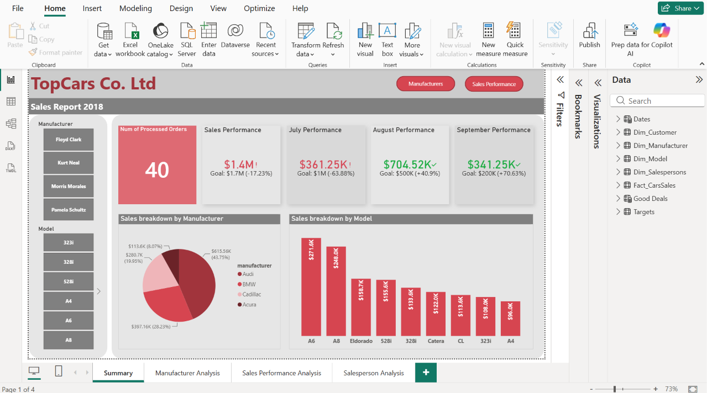
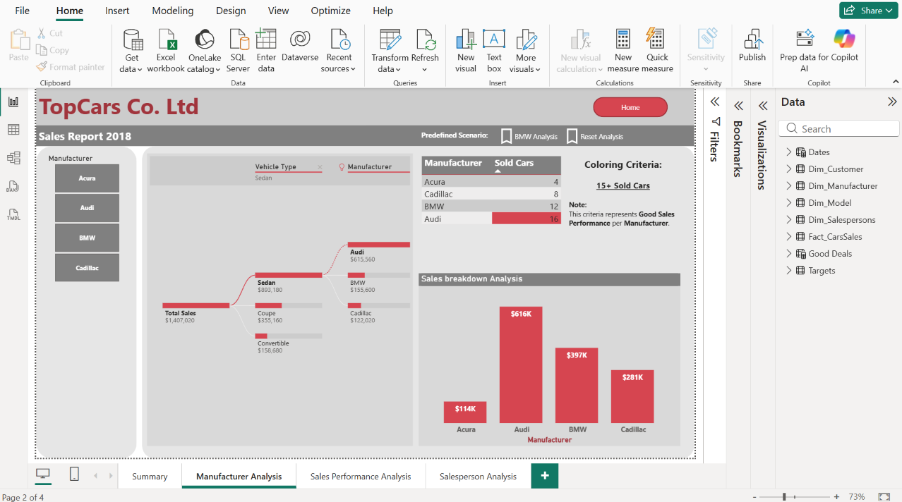
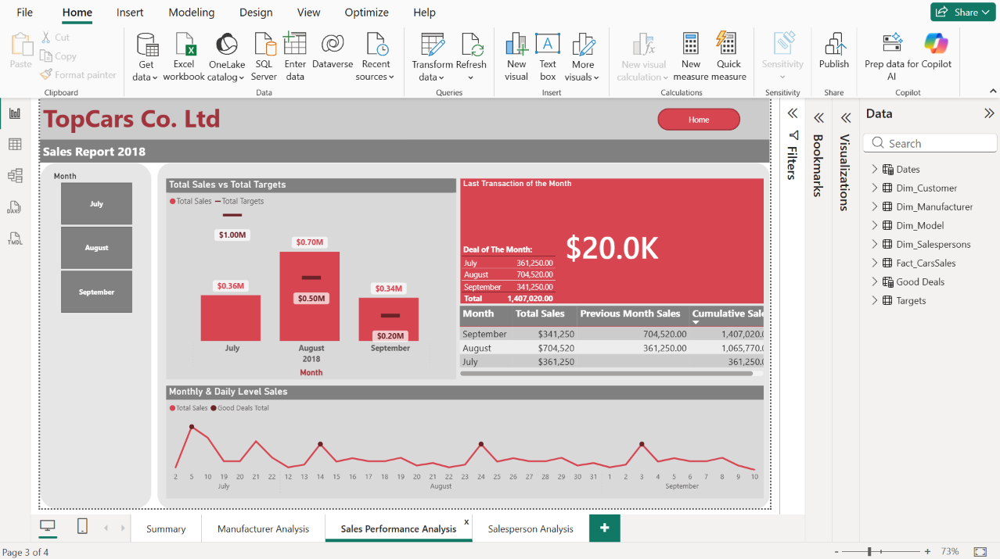
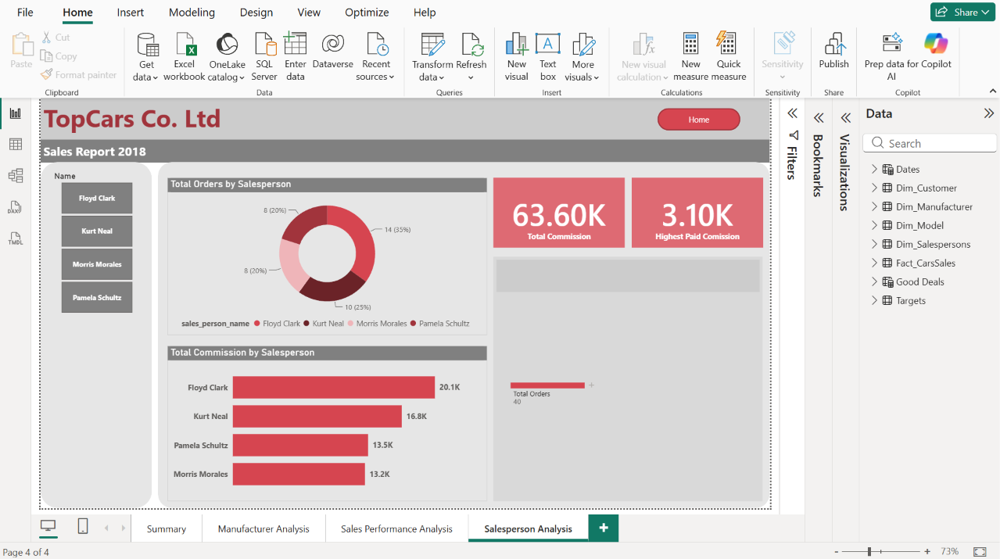
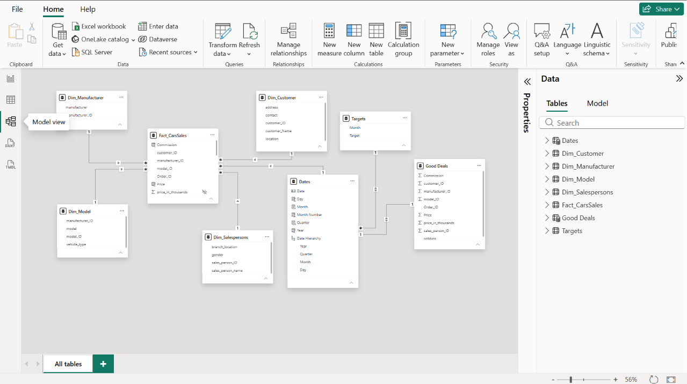

# Car Sales Analysis — Power BI

A Power BI project completed as part of a data analysis course assessment using a provided reference design.

The project covers data cleaning, table relationships, calculations, and interactive reporting using the TopCars Co. Ltd sales dataset for July–September 2018.

## Project Work

- Cleaned and prepared data for analysis.
- Organized data tables and established relationships between sales, customers, manufacturers, vehicle models, salespeople, and dates.
- Created calculations to analyze sales, commissions, targets, previous-month sales, and cumulative sales.
- Built four interactive report pages with charts, KPI cards, tables, and filters.
- Added navigation buttons and bookmarks for predefined analysis views and presentations.

## Report Pages

### 1. Summary
An overview of processed orders, total sales, monthly performance against targets, and sales by manufacturer and vehicle model.

### 2. Manufacturer Analysis
A comparison of manufacturers by sales and cars sold, including conditional formatting and bookmarks for BMW analysis and resetting the view.

### 3. Sales Performance Analysis
Monthly sales against targets, previous-month and cumulative sales, daily sales trends, and the last transaction of the month.

### 4. Salesperson Analysis
A comparison of salespeople by order count and commission, with total and highest paid commission indicators.

## Data Model

The model includes these tables:

- Fact_CarsSales
- Dim_Customer
- Dim_Manufacturer
- Dim_Model
- Dim_Salespersons
- Dates
- Targets
- Good Deals

Relationships connect the tables to support filtering and analysis across the report.

## Tools Used

- Microsoft Power BI Desktop

## Project Context

This was a learning and assessment project. I implemented the report using the course reference design and practiced data preparation, modeling, calculations, and interactive reporting.

## About This Repository

This repository presents the project through documentation and screenshots. The Power BI (.pbix) file and underlying dataset are not included.

## Project Screenshots

### Summary

### Manufacturer Analysis

### Sales Performance Analysis

### Salesperson Analysis

### Data Model

